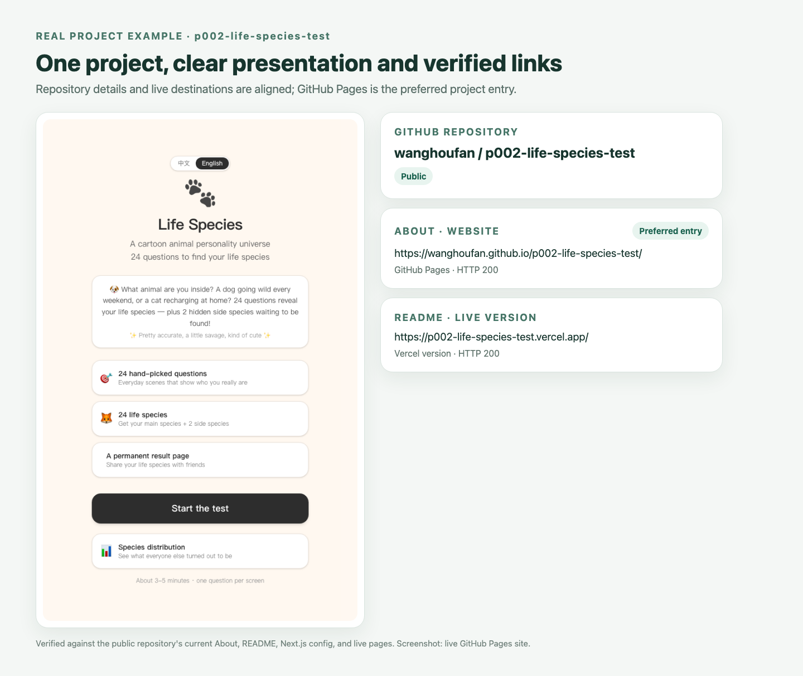
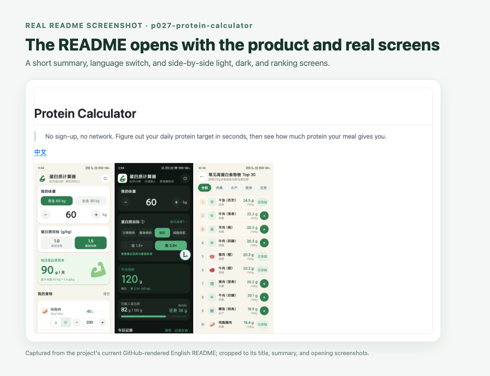
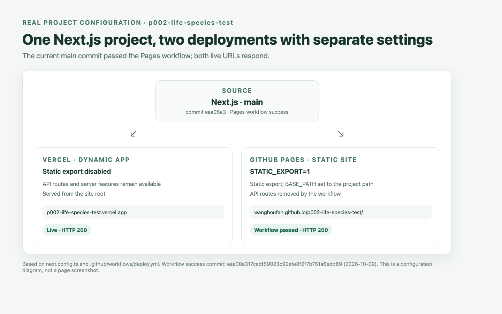

# Curated Skills

[简体中文](README.md) · English

#### AI skills selected, refined, and used in real projects.

Each skill has been tried on a concrete task before being adapted into instructions others can understand and use. This repository is now **Public** and continues to be curated.

---

## 📋 Contents

| Name | In one sentence |
|---|---|
| [github-project-showcase（GitHub 项目展示同步）](skills/github-project-showcase/SKILL.en.md) | At project wrap-up, align descriptions, links, and screenshots across the repository, bilingual profile, and portfolio. |
| [github-readme-maintainer（GitHub README 维护）](skills/github-readme-maintainer/SKILL.en.md) | Maintain the README, product screenshots, and Releases; prepare APKs and bilingual notes for Android releases. |
| [nextjs-github-pages-deploy（Next.js 部署 GitHub Pages）](skills/nextjs-github-pages-deploy/SKILL.en.md) | Deploy Next.js to GitHub Pages, handle subpaths and assets, and keep Vercel when needed. |

---

## 📦 Install

In an agent that supports `SKILL.md`, ask it to install the skill and provide the matching folder URL. For example:

```text
Please read and install this skill:
https://github.com/wanghoufan/alw-003-curated-skill-open-source/tree/main/skills/github-readme-maintainer
```

Replace the folder name with the skill you want. This repository is public, so the GitHub identity used by the agent needs no extra read access. You can also clone the repository and install the skill folder according to your agent's instructions.

---

## ✨ Skills

### 🧭 github-project-showcase（GitHub 项目展示同步）

> When a project is ready, its repository and portfolio descriptions should be in sync too.

This skill prepares **one named project** for presentation. It checks repository facts, links, and screenshots, then updates only the GitHub repository, bilingual profile, or portfolio destinations you specify. When Chinese and English profile READMEs both exist, it keeps their project lists and categories aligned and runs a read-only check. It does not invent features or put a private project on a public page.



*Real example from the public `p002-life-species-test` project; screenshots and links were checked against the current repository and live sites.*

**Best for**: Wrapping up one project, checking its presentation, or verifying portfolio links and screenshots. It is not an account-wide portfolio audit.

**How to trigger it**

```text
This project is wrapping up. Sync its repository description and portfolio entry.
Check whether this GitHub repository's description, website link, and screenshots are accurate.
Add this project to my GitHub profile README, checking for duplicates first.
```

[Read the full skill](skills/github-project-showcase/SKILL.en.md)

---

### 📝 github-readme-maintainer（GitHub README 维护）

> Help a first-time visitor understand the project, run it, and see what changed in every release.

This skill maintains the README, GitHub About, and Releases from verified project details. Products with a UI get genuine screenshots near the top: major mobile tabs in one row, or a website home page plus only a few key views. For a formal Android release, it checks the signed APK and prepares bilingual release notes.



*Captured from the current GitHub-rendered README of the public `p027-protein-calculator` project.*

**Best for**: Creating or updating a README, reviewing GitHub About, preparing product screenshots, or publishing an Android APK with bilingual release notes.

**How to trigger it**

```text
Update the Chinese and English READMEs from the current code, with genuine screenshots near the top.
Check whether this repository's GitHub About website should prefer GitHub Pages.
Prepare a GitHub Release for this Android version, attach the signed APK, and write bilingual notes.
```

[Read the full skill](skills/github-readme-maintainer/SKILL.en.md)

---

### 🚀 nextjs-github-pages-deploy（Next.js 部署 GitHub Pages）

> The tricky parts of publishing a Next.js project site are its subpath and static-export limits.

It checks whether the app can be statically exported, then handles `basePath`, asset paths, dynamic routes, and the Actions workflow. If Vercel stays in place, it separates the two build configurations and verifies both live targets.



*Based on the public `p002-life-species-test` project's Next.js config, Pages workflow, and current live status; this is a configuration diagram.*

**Best for**: Deploying a Next.js project site to GitHub Pages, adding Pages as a mirror for Vercel, or diagnosing blank pages and missing assets. Features that require a server cannot be preserved by static export alone.

**How to trigger it**

```text
Deploy this Next.js project to GitHub Pages.
I want to keep Vercel and add a GitHub Pages version; check what needs to change.
The Pages site is blank. Check basePath, routes, and asset paths.
```

[Read the full skill](skills/nextjs-github-pages-deploy/SKILL.en.md)

---

## About

This is a personally maintained collection. The repository is public and its content is offered under the [MIT License](LICENSE); the scope of each skill will keep being reviewed.
